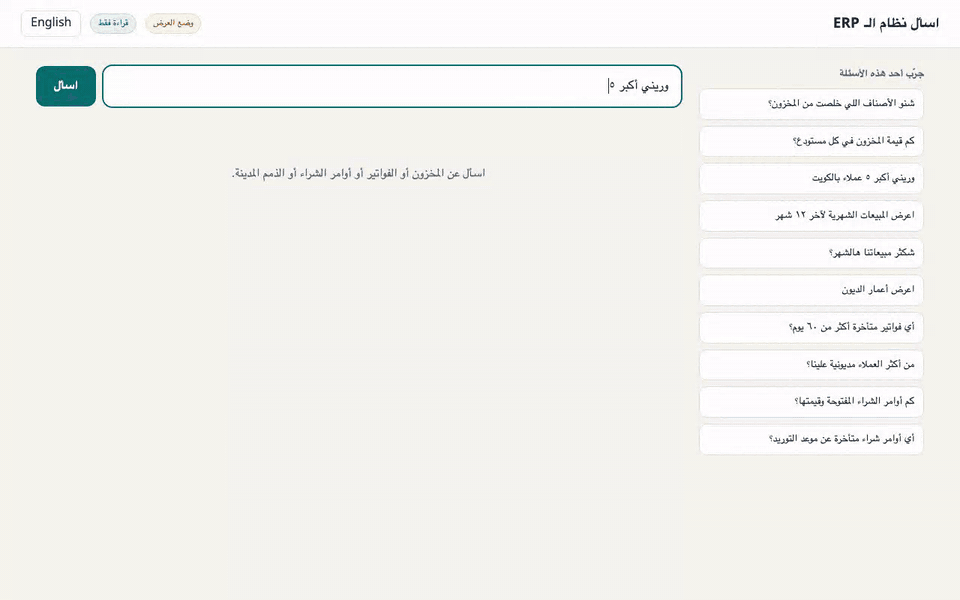
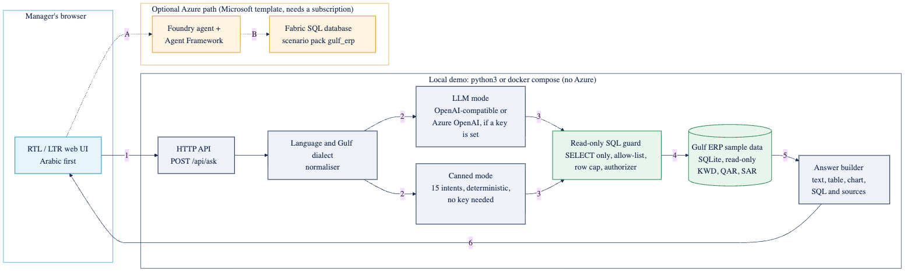
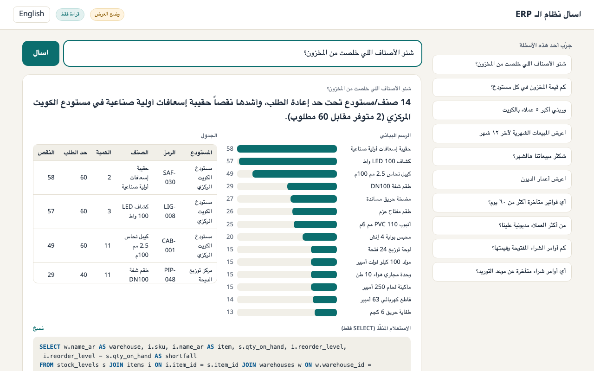
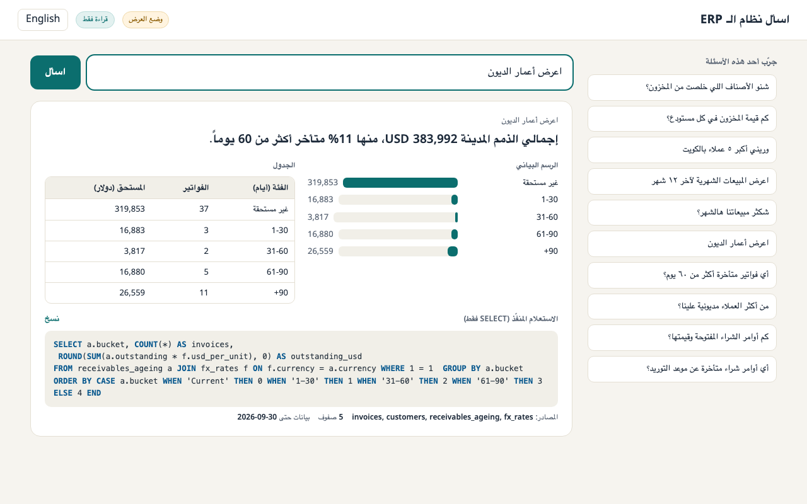
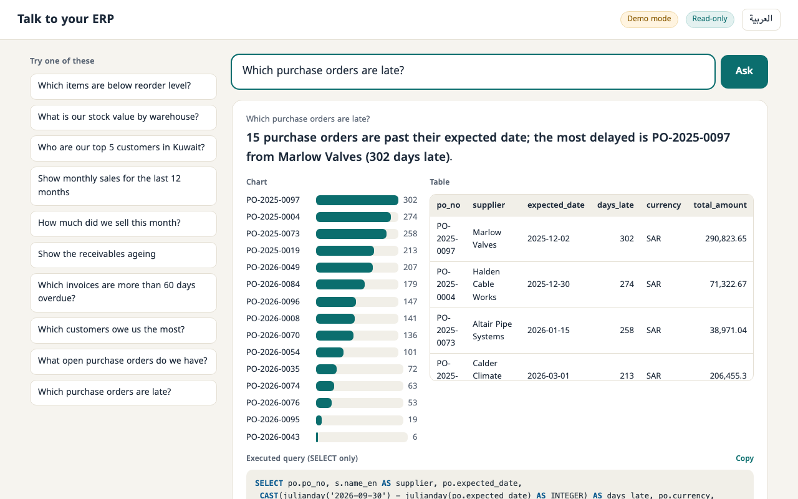
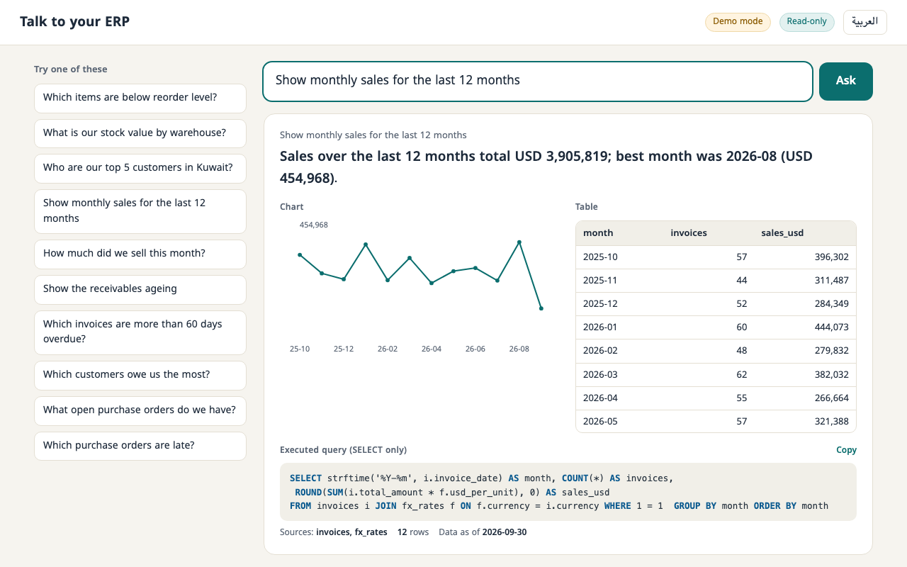

# Talk to your ERP, Gulf edition

> **Managers ask the ERP questions in Arabic or English (stock, invoices, purchase orders, receivables) and get a sourced answer, a table and a chart in seconds, instead of waiting days for an analyst report.**

**Answers, not reports.**



[MP4](gulf-edition/docs/demo.mp4) | [poster](gulf-edition/docs/poster.png) | the demo above is the real UI in demo mode, 1280x800, no mocked frames.

## Built on Microsoft's template (MIT)

Built on Microsoft's [Agentic Applications for Unified Data Foundation](https://github.com/microsoft/agentic-applications-for-unified-data-foundation-solution-accelerator) solution accelerator (MIT). This repository is a fork: the upstream code, `LICENSE` and notices are unchanged, and the original README is kept as [README.upstream.md](README.upstream.md). The upstream Foundry agents + Fabric deployment still works as documented there.

**My additions** (everything is in `gulf-edition/` plus one scenario pack):

1. **Arabic first.** RTL UI, Gulf dialect handling (for example "شنو الأصناف اللي خلصت" or "شكثر مبيعاتنا هالشهر"), Arabic digits, and answers in the language of the question. Table headers, names and values come back in Arabic when you ask in Arabic.
2. **Realistic Gulf sample ERP.** 54 customers, 12 suppliers, 48 items, 4 warehouses, about 600 invoices in KWD, QAR and SAR, 110 purchase orders and a receivables ageing view. All company names are invented; any resemblance to a real business is a coincidence.
3. **Read-only SQL safety.** Four layers: a text guard (single SELECT or WITH, forbidden keywords), a table allow-list, a SQLite authorizer that denies every non-read action and unknown table or function, and a read-only connection with a 200 row cap and a runaway-query watchdog. The executed SQL and the tables it read are shown under every answer.
4. **Local demo mode.** `./gulf-edition/run.sh` or `docker compose up`, no Azure subscription. If `OPENAI_API_KEY` or `AZURE_OPENAI_*` exist, a real model writes the SQL; otherwise 15 deterministic intents answer (10 are offered as showcase questions) with live numbers from the database.
5. **Eval.** `gulf-edition/eval/run_eval.py` runs 20 golden questions (English, Arabic and Gulf dialect) and passes or fails each on SQL correctness against a hand-written gold query, plus 8 unsafe statements that must be blocked.
6. **Azure scenario pack.** `data/scenarios/gulf_erp/` (CSV tables, ontology, sample questions, entry in `scenarios.json`) so the upstream accelerator can deploy the same data to Fabric.

## Architecture



1. The browser sends the question. 2. Language and Gulf dialect are normalised, then either the LLM or the canned engine proposes SQL. 3. The read-only guard checks it. 4. It runs on a read-only SQLite connection. 5. Rows come back. 6. The UI shows answer, chart, table, SQL and sources. A and B: the optional upstream path through a Foundry agent and Fabric, which needs an Azure subscription.

## Quickstart

```bash
git clone https://github.com/BenjisCollector/talk-to-your-erp-gulf && cd talk-to-your-erp-gulf/gulf-edition
./run.sh                 # needs only Python 3.9+, opens on http://127.0.0.1:8080
# or
docker compose up        # http://localhost:8080
```

Optional real model: `export OPENAI_API_KEY=...` (add `OPENAI_BASE_URL` for any OpenAI-compatible server) or the `AZURE_OPENAI_*` variables in `.env.example`, then restart. If the model is unreachable the app falls back to demo answers and says so.

Checks: `python3 eval/run_eval.py`, `python3 tests/test_guard.py`, `python3 tests/test_llm_mode.py` (the last one uses a local mock endpoint).

## What runs where

| | Demo mode (local) | Needs Azure |
|---|---|---|
| Arabic and English UI, table, chart, SQL, sources | yes | |
| Showcase questions with live data | yes | |
| Free-form questions | with an OpenAI-compatible key | |
| Foundry agent, Fabric SQL, Entra auth, chat history (upstream) | | yes |

Demo mode only understands its 15 intents; anything else says so instead of guessing. Data is frozen at 2026-09-30 so answers are reproducible. I could not run `docker compose` on my machine (Docker is not installed there); the same entrypoint was tested through `run.sh`, and the Azure path was not deployed.

## Screenshots

| | |
|---|---|
|  |  |
|  |  |

Regenerate the loop with `python3 gulf-edition/docs/record_demo.py` then `gulf-edition/docs/encode.sh` (needs Playwright and ffmpeg).

## License

MIT, as upstream. See [LICENSE](LICENSE).
